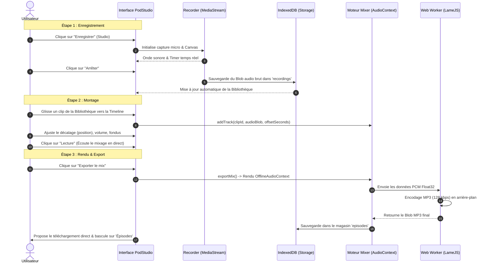

# Documentation Fonctionnelle et Technique — PodStudio Static

> **PodStudio Static** est une Progressive Web App (PWA) d'enregistrement, de montage multipiste et de publication de podcasts, s'exécutant à 100 % dans le navigateur web sans aucun serveur applicatif (architecture *Serverless* / *Static Web*).

---

## Sommaire

1. [Anatomie de l'Interface Utilisateur (UI)](#1-anatomie-de-linterface-utilisateur-ui)
   - [1.1 Structure Globale et Layout](#11-structure-globale-et-layout)
   - [1.2 Design System et Identité Visuelle](#12-design-system-et-identité-visuelle)
   - [1.3 Description Détaillée des Vues](#13-description-détaillée-des-vues)
   - [1.4 Le Panneau Bibliothèque](#14-le-panneau-bibliothèque)
2. [Fonctionnement et Expérience Utilisateur (UX)](#2-fonctionnement-et-expérience-utilisateur-ux)
   - [2.1 Principes Directeurs UX](#21-principes-directeurs-ux)
   - [2.2 Parcours Utilisateur : De l'Enregistrement à l'Export](#22-parcours-utilisateur--de-lenregistrement-à-lexport)
   - [2.3 Ergonomie Desktop vs Expérience Mobile](#23-ergonomie-desktop-vs-expérience-mobile)
   - [2.4 Fonctionnement Hors-Ligne et PWA](#24-fonctionnement-hors-ligne-et-pwa)
3. [Architecture et Contenu du Code](#3-architecture-et-contenu-du-code)
   - [3.1 Schéma d'Architecture Globale](#31-schéma-darchitecture-globale)
   - [3.2 Pipeline Audio (Capture -> Mixage -> Encodage MP3)](#32-pipeline-audio)
   - [3.3 Analyse Module par Module](#33-analyse-module-par-module)
   - [3.4 Déploiement et CI/CD (La Forge des Communs)](#34-déploiement-et-cicd)

---

## 1. Anatomie de l'Interface Utilisateur (UI)

### 1.1 Structure Globale et Layout

L'application est conçue comme une **Single Page Application (SPA)** plein écran (`100vh`), sans rechargement de page. L'écran se divise en 3 grands espaces sur ordinateur :

```
┌────────────────────────────────────────────────────────────────────────┐
│ HEADER : Logo PodStudio Static 🎙️       [📚 Ouvrir Bibliothèque (Mob)] │
├──────────┬──────────────────────────────────────────────┬──────────────┤
│ SIDEBAR  │ ZONE CENTRALE (VUES)                         │ BIBLIOTHÈQUE │
│          │                                              │              │
│ 📖 Guide │  • Guide pas-à-pas (Onboarding)              │ + Import     │
│ 🔴 Studio│  • Studio d'enregistrement (Canvas + Timer)  ├──────────────┤
│ 🎚️ Éditeur│  • Éditeur Timeline horizontale (Briques)    │ [Audio 1] ▶️ │
│ 🚀 Épis. │  • Épisodes finaux (Lecteur + Flux RSS)      │ [Audio 2] ▶️ │
│          │  • Paramètres & Stockage                     │ [Audio 3] ▶️ │
│ ⚙️ Param.│                                              │              │
├──────────┴──────────────────────────────────────────────┴──────────────┤
│ [MOBILE UNIQUEMENT] BARRE DE NAVIGATION INFÉRIEURE : 📖 🔴 🎚️ 🚀 ⚙️    │
└────────────────────────────────────────────────────────────────────────┘
```

1. **L'En-tête (`.app-header`)** :
   - Logo avec dégradé textuel lumineux et icône stylisée `🎙️ PodStudio [Static]`.
   - Bouton d'accès rapide à la bibliothèque sur mobile (`#mob-library-toggle`).
   - Ligne inférieure luminescente avec dégradé violet néon.
2. **La Barre Latérale Gauche (`.app-sidebar`)** :
   - Navigation verticale avec icônes et intitulés textuels : *Guide*, *Studio*, *Éditeur*, *Épisodes*, et *Paramètres*.
   - Indicateur actif marqué par une barre lumineuse latérale et une surbrillance douce.
3. **La Zone de Contenu Central (`#app-content` / `.view-wrapper`)** :
   - Affiche dynamiquement l'une des 5 vues principales selon la navigation.
4. **La Bibliothèque Audio Droite (`.app-library-sidebar`)** :
   - Panneau latéral permanent sur PC, contenant les fichiers audio bruts (enregistrements vocaux et sons importés).

---

### 1.2 Design System et Identité Visuelle

L'interface repose sur une esthétique moderne **Dark Studio** avec touches **Glassmorphism** et contrastes néons :

* **Palette de Couleurs** (définie dans [`css/variables.css`](file:///c:/Users/alano/OneDrive/Documents/GitHub/Podstudio-static/css/variables.css)) :
  - **Fonds immersifs** : `#080810` (fond principal très sombre), `#0f0f17` (surfaces de navigation), `#15151f` (cartes et panneaux).
  - **Violet Studio (Primaire)** : `#8940fa` (boutons d'action, surbrillance, clips vocaux).
  - **Rouge Enregistrement (Accent)** : `#ff0055` (bouton d'enregistrement, pulsations d'alerte, indicateur "Live").
  - **Turquoise Émeraude (Succès)** : `#22d3a5` (fichiers importés, validations, statuts positifs).
  - **Typographie** : Famille unique **Inter** (Google Fonts) avec graisses contrastées (400 à 900) pour une lisibilité optimale sur écran.
* **Effets & Micro-interactions** :
  - Flous d'arrière-plan (*backdrop-filter: blur(12px)*).
  - Pulsations visuelles lors de l'enregistrement.
  - Ombres portées colorées (*glow effects*) pour détacher les éléments interactifs.

---

### 1.3 Description Détaillée des Vues

#### Vue 1 : Guide (`#view-guide`) — Vue par défaut à l'ouverture
* **Objectif** : Accueillir l'utilisateur et lui donner le mode d'emploi immédiat.
* **Composants** :
  - 4 cartes d'étapes numérotées :
    1. *Enregistrez vos voix* (avec un bouton d'action directe `Aller au Studio →`).
    2. *Gérez votre bibliothèque* (explication des formats `.wav` et `.mp3`).
    3. *Montez votre épisode* (glisser-déposer sur la timeline).
    4. *Exportez et partagez* (génération du fichier final et flux RSS).
  - Pied de page rappelant que **tout reste stocké localement** dans le navigateur (respect total de la vie privée).

#### Vue 2 : Studio d'Enregistrement (`#view-record`)
* **Objectif** : Capter la voix de l'utilisateur avec retour temps réel.
* **Composants** :
  - **Visualiseur Audio (`#audio-visualizer`)** : Canvas HTML5 dessinant une onde sinusoïdale dynamique qui réagit au volume sonore capté par le microphone.
  - **Chronomètre d'Enregistrement (`.timer-display`)** : Affiche le temps écoulé en format `00:00:00`.
  - **Pastille de statut (`#recording-status`)** : Indique `Prêt`, `Enregistrement en direct` (rouge clignotant) ou `En pause`.
  - **Grand Bouton d'Enregistrement (`#btn-record`)** : Cercle tactile de grand diamètre avec animation d'onde lumineuse.
  - **Contrôles secondaires** : Boutons pause (`⏸️`) et arrêt (`⏹️`) qui apparaissent dès que la captation est active.

#### Vue 3 : Éditeur de Montage (`#view-editor`)
* **Objectif** : Assembler, décaler dans le temps et mixer plusieurs pistes audio.
* **Composants** :
  - **Barre de Transport (`.editor-toolbar`)** : Boutons Lecture (`▶️`), Arrêt (`⏹️`), et affichage du temps de lecture (`#editor-time`).
  - **Bouton d'Exportation (`#btn-export-mix`)** : Déclenche le rendu final et l'encodage MP3.
  - **Réglette Temporelle (`#timeline-ruler`)** : Graduations en secondes (0s, 5s, 10s...) synchronisées avec le défilement horizontal.
  - **Piste de Montage (`#timeline-tracks`)** : Zone horizontale où les clips audio apparaissent sous forme de **briques colorées** déplaçables.
  - **Tête de Lecture (`#timeline-playhead`)** : Ligne verticale lumineuse qui avance au fil de la lecture audio.
  - **Commandes de clip individuelles** : Chaque brique audio dispose d'un potentiomètre de volume (`0%` à `100%`), de boutons de fondus (*Fade in / Fade out*) et d'un bouton de suppression (`✕`).

#### Vue 4 : Épisodes Publiés (`#view-episodes`)
* **Objectif** : Écouter, télécharger les mixages terminés et exporter le flux RSS.
* **Composants** :
  - **Bouton Export RSS / XML (`#btn-export-all`)** : Génère et télécharge le fichier `podcast.xml`.
  - **Grille des épisodes (`#episodes-list`)** : Cartes récapitulatives de chaque épisode contenant :
    - Titre et date de création.
    - Lecteur audio HTML5 natif pour écoute immédiate.
    - Bouton de téléchargement du fichier MP3.
    - Bouton de suppression de l'épisode.

#### Vue 5 : Paramètres (`#view-settings`)
* **Objectif** : Configurer les métadonnées globales du podcast et surveiller l'espace disque.
* **Composants** :
  - **Formulaire Métadonnées (`#settings-form`)** : Titre du podcast, description, auteur, email de contact, et langue (ex: `fr`).
  - **Bouton de sauvegarde** : Avec confirmation visuelle instantanée (`✓ Sauvegardé !`).
  - **Jauge d'espace disque (`#storage-quota`)** : Barre de progression indiquant l'espace mémoire consommé dans le navigateur (IndexedDB).
  - **Zone Danger / Réinitialisation (`#btn-delete-all`)** : Bouton de purge intégrale des données (conformité RGPD / remise à zéro).

---

### 1.4 Le Panneau Bibliothèque

Accessible en permanence sur ordinateur (panneau de droite) et sous forme de **volet coulissant inférieur** (*Bottom Sheet*) sur mobile :
* **Bouton d'importation (`+ Import`)** : Permet d'importer des fichiers musicaux, bruitages ou voix externes (`.mp3`, `.wav`).
* **Liste des pistes disponibles** :
  - Chaque piste dispose d'un lecteur miniature pour pré-écoute rapide.
  - Poignée de glisser-déposer (*Drag handle*) pour glisser le clip directement sur la timeline de l'éditeur.
  - Bouton d'ajout direct sur la timeline (+).
  - Renommage en direct du nom du fichier.
  - Suppression de la piste.

---

## 2. Fonctionnement et Expérience Utilisateur (UX)

### 2.1 Principes Directeurs UX

1. **Zéro Inscription, Zéro Barrière** : L'utilisateur ouvre l'URL et commence immédiatement à enregistrer. Aucun compte, mot de passe ni configuration serveur ne sont nécessaires.
2. **Confidentialité Totale (Privacy First)** : Aucun octet d'enregistrement ne transite par un serveur externe. Tout est traité et stocké localement dans la base de données du navigateur du podcasteur.
3. **Résilience et Tolérance aux Erreurs** :
   - Mise en pause sans perte de buffer.
   - Sauvegarde immédiate dans IndexedDB à la fin d'un enregistrement.
   - Prévention des manipulations destructrices (boîtes de dialogue de confirmation avant suppression).
4. **Retour d'État Transparent** : L'utilisateur sait toujours ce que fait l'application (animation d'ondes lors de la captation, état de rendu lors de l'export, retour `✓ Sauvegardé !` dans les formulaires).

---

### 2.2 Parcours Utilisateur : De l'Enregistrement à l'Export



---

### 2.3 Ergonomie Desktop vs Expérience Mobile

L'application intègre une détection adaptative poussée :

| Aspect | Expérience Desktop (Écrans larges / 16:9) | Expérience Mobile (Smartphones / 9:16) |
|---|---|---|
| **Navigation** | Barre latérale gauche fixe (`180px` à `240px`) | Barre de navigation basse (*Bottom Nav*) avec boutons tactiles de `48px` minimum |
| **Bibliothèque** | Volet latéral droit toujours ouvert | Modale coulissante depuis le bas de l'écran (*Bottom Sheet*) activable par le bouton 📚 du header |
| **Timeline** | Glisser-déposer souris natif (`HTML5 Drag and Drop`) | Ajout direct par bouton tactile, interface optimisée pour le défilement tactile |
| **Canvas Visualiseur** | Grand format panoramique avec haute résolution | Canvas adaptatif centré au-dessus des commandes tactiles |
| **Zone de confort** | Interactions au survol (*hover*), curseurs personnalisés | Zones d'appui agrandies, protection contre le zoom accidentel (`viewport-fit=cover`) |

---

### 2.4 Fonctionnement Hors-Ligne et PWA

* **Manifeste PWA ([`manifest.json`](file:///c:/Users/alano/OneDrive/Documents/GitHub/Podstudio-static/manifest.json))** :
  - Permet d'installer PodStudio sur l'écran d'accueil d'un smartphone (iOS/Android) ou comme une application de bureau native (Chrome, Edge, macOS).
  - Mode d'affichage `standalone` sans barre d'adresse de navigateur.
* **Service Worker ([`sw.js`](file:///c:/Users/alano/OneDrive/Documents/GitHub/Podstudio-static/sw.js))** :
  - Intercepte les requêtes réseau et met en cache l'ensemble des fichiers HTML, CSS, JavaScript et polices.
  - Permet d'ouvrir et d'utiliser l'ensemble du studio audio **en plein vol, dans le train ou en l'absence totale de réseau Internet**.

---

## 3. Architecture et Contenu du Code

### 3.1 Schéma d'Architecture Globale

```
├── index.html                   # Point d'entrée DOM unique (SPA)
├── manifest.json & sw.js        # Support PWA & Stratégie Offline
│
├── css/
│   ├── variables.css            # Tokens de style (thème sombre, couleurs néon, typographies)
│   └── style.css                # Règles CSS globales, responsive & animations
│
├── js/
│   ├── app.js                   # Orchestrateur racine & initialisation
│   ├── ui.js                    # Gestion du DOM, navigation et bibliothèque
│   ├── recorder.js              # Capture microphone & visualiseur Canvas
│   ├── mixer.js                 # Moteur Web Audio multipiste
│   ├── timeline-ui.js           # Contrôleur graphique de la timeline
│   ├── storage.js               # Façade de stockage (LocalStorage + IndexedDB)
│   ├── db.js                    # Gestionnaire bas niveau IndexedDB
│   ├── settings.js              # Formulaire de métadonnées et quotas
│   ├── rss.js                   # Générateur de flux RSS compatible iTunes
│   └── audio-worker.js          # Web Worker d'encodage MP3 LAME
│
└── vendor/
    └── lame.min.js              # Librairie d'encodage audio MP3 (LGPL)
```

---

### 3.2 Pipeline Audio

L'application exploite deux contextes audio distincts de la spécification **Web Audio API** :

1. **`AudioContext` (Temps Réel)** :
   - Utilisé dans `recorder.js` pour connecter le flux micro à un `AnalyserNode` calculant la transformée de Fourier rapide (FFT) afin d'animer l'onde du canvas à 60 FPS.
   - Utilisé dans `mixer.js` pour jouer simultanément plusieurs buffers audio à des décalages temporels précis (`offset`), avec gestion du volume par `GainNode`.
2. **`OfflineAudioContext` (Rendu Hors-Ligne Accéléré)** :
   - Permet de mixer toutes les pistes de la timeline à la vitesse maximale du processeur (un podcast de 10 minutes est mixé en 1 à 2 secondes).
   - Les données résultantes sous forme d'échantillons PCM Float32 sont transmises au **Web Worker**.
3. **`Web Worker` (Encodage LAME MP3)** :
   - Exécuté dans un thread séparé pour ne jamais figer l'interface utilisateur.
   - Convertit les Float32 en entiers signés 16 bits (`Int16Array`) puis compresse en trames MP3 de 1152 échantillons à 128 kbps.

---

### 3.3 Analyse Module par Module

#### 1. [`index.html`](file:///c:/Users/alano/OneDrive/Documents/GitHub/Podstudio-static/index.html)
* **Rôle** : Structure sémantique complète de la SPA.
* **Éléments clés** :
  - Balises `<meta>` pour la compatibilité PWA (`theme-color`, `mobile-web-app-capable`).
  - Découpage en sections `<section class="view">` activées ou masquées via la classe `.active` / `.hidden`.
  - Éléments d'accessibilité ARIA (`role="status"`, `aria-live="polite"`, `aria-label`).
  - Chargement du script vendor `lame.min.js` puis du module racine ES6 `app.js`.

#### 2. [`css/variables.css`](file:///c:/Users/alano/OneDrive/Documents/GitHub/Podstudio-static/css/variables.css) et [`css/style.css`](file:///c:/Users/alano/OneDrive/Documents/GitHub/Podstudio-static/css/style.css)
* **Rôle** : Design System, disposition dynamique et adaptabilité multi-écrans.
* **Éléments clés** :
  - `variables.css` centralise les tokens CSS (`--bg-main`, `--primary`, `--accent`, `--glass-blur`, etc.).
  - `style.css` met en œuvre des grilles CSS complexes (`CSS Grid`) et des boîtes flexibles (`Flexbox`) adaptées à 3 paliers : Smartphones (`< 768px`), Tablettes (`768px–1023px`), et Écrans larges (`≥ 1024px`).

#### 3. [`js/app.js`](file:///c:/Users/alano/OneDrive/Documents/GitHub/Podstudio-static/js/app.js)
* **Rôle** : Point d'entrée de l'application au chargement du DOM.
* **Fonctions clés** :
  - Initialise les bases de données et les modules dans l'ordre de dépendance : `Storage.init()`, `Settings.init()`, `UI.init()`, `Recorder.init()`, `TimelineUI.init()`.
  - Enregistre le Service Worker (`sw.js`).

#### 4. [`js/ui.js`](file:///c:/Users/alano/OneDrive/Documents/GitHub/Podstudio-static/js/ui.js)
* **Rôle** : Chef d'orchestre de l'interface graphique.
* **Fonctions clés** :
  - `setupNavigation()` & `setupMobileNavigation()` : commutation des vues sans rechargement.
  - `refreshLibraryList()` & `refreshMobileLibraryList()` : lecture de la base IndexedDB et génération dynamique des cartes audio avec lecteurs intégrés.
  - `setupImportFile()` : traitement des fichiers `.mp3` et `.wav` sélectionnés par l'utilisateur et insertion dans la bibliothèque.
  - `refreshEpisodesList()` : affichage des mixages finaux exportés.
  - `updateStorageInfo()` : interrogation de l'API `navigator.storage.estimate()` pour afficher l'espace mémoire consommé.

#### 5. [`js/recorder.js`](file:///c:/Users/alano/OneDrive/Documents/GitHub/Podstudio-static/js/recorder.js)
* **Rôle** : Moteur de captation audio en direct.
* **Fonctions clés** :
  - `startRecording()` : demande l'accès au micro via `navigator.mediaDevices.getUserMedia()`, instancie `MediaRecorder` et démarre le flux.
  - `drawVisualizer()` : boucle `requestAnimationFrame` dessinant en continu l'oscillogramme sur le `<canvas>`.
  - `togglePause()` : gestion de l'état pause/reprise sans perte de synchronisation temporelle.
  - `stopRecording()` : finalise l'assemblage des paquets audio (`audioChunks`), crée un `Blob` audio et l'enregistre via `Storage.saveRecording()`.

#### 6. [`js/mixer.js`](file:///c:/Users/alano/OneDrive/Documents/GitHub/Podstudio-static/js/mixer.js)
* **Rôle** : Cœur algorithmique de mixage multipiste.
* **Fonctions clés** :
  - `addTrack(id, audioSource, offset)` : décode le binaire audio via `audioContext.decodeAudioData()` et stocke la piste avec son décalage temporel en secondes.
  - `play()` / `stop()` : synchronise et démarre la lecture de toutes les pistes actives à leur instant `offset` respectif.
  - `setTrackVolume(id, volume)` & `setTrackFade(id, fadeIn, fadeOut)` : applique les courbes d'atténuation sonore.
  - `exportMix()` : instancie un `OfflineAudioContext` de durée égale à la fin du dernier clip, rend le mixage à pleine vitesse, puis transmet les données au Web Worker d'encodage MP3.

#### 7. [`js/timeline-ui.js`](file:///c:/Users/alano/OneDrive/Documents/GitHub/Podstudio-static/js/timeline-ui.js)
* **Rôle** : Représentation visuelle et interactive de la timeline.
* **Fonctions clés** :
  - `generateRuler()` : dessine les repères temporels gradués (toutes les secondes / toutes les 5 secondes).
  - Événements de Drag & Drop : conversion de la position horizontale de la souris en secondes (`offset = dropX / PIXELS_PER_SECOND`).
  - Déplacement libre des blocs audio sur la piste avec persistance de leur nouvelle position temporelle.
  - Animation de la tête de lecture (`#timeline-playhead`) synchronisée avec le temps courant du mixeur.

#### 8. [`js/storage.js`](file:///c:/Users/alano/OneDrive/Documents/GitHub/Podstudio-static/js/storage.js) et [`js/db.js`](file:///c:/Users/alano/OneDrive/Documents/GitHub/Podstudio-static/js/db.js)
* **Rôle** : Persistance des données.
* **Architecture du stockage** :
  - **IndexedDB (`PodcastStudioDB` v2)** : stocke les gros volumes binaires (`Blob`) dans deux magasins distincts :
    - `recordings` : enregistrements vocaux bruts et sons importés.
    - `episodes` : mixages finaux montés.
  - **LocalStorage (`podcast_settings`)** : stocke les métadonnées légères (titre, auteur, description, email, langue).

#### 9. [`js/settings.js`](file:///c:/Users/alano/OneDrive/Documents/GitHub/Podstudio-static/js/settings.js)
* **Rôle** : Gestion du formulaire de métadonnées.
* **Fonctions clés** :
  - `loadSettingsIntoForm()` : pré-remplit les champs à partir du LocalStorage.
  - `saveFormSettings()` : valide et enregistre les valeurs de façon sécurisée (avec gestion des valeurs par défaut si un champ est omis) et affiche le retour visuel `✓ Sauvegardé !` sur le bouton.

#### 10. [`js/rss.js`](file:///c:/Users/alano/OneDrive/Documents/GitHub/Podstudio-static/js/rss.js)
* **Rôle** : Exportation et syndication.
* **Fonctions clés** :
  - `generateRSS(episodes)` : construit dynamiquement une chaîne XML normalisée conforme aux spécifications **RSS 2.0** et **iTunes Podcasts** (balises `<itunes:author>`, `<itunes:summary>`, `<itunes:owner>`, `<enclosure url="..." type="audio/mp3">`).
  - Génère un fichier téléchargeable au format `application/xml`.

#### 11. [`js/audio-worker.js`](file:///c:/Users/alano/OneDrive/Documents/GitHub/Podstudio-static/js/audio-worker.js)
* **Rôle** : Encodage MP3 multithread.
* **Fonctions clés** :
  - Charge `vendor/lame.min.js`.
  - Convertit les tampons audio Float32 en PCM Int16.
  - Découpe et compresse le flux par blocs de 1152 échantillons.
  - Émet un message `complete` contenant le `Blob` MP3 final prêt pour le téléchargement.

---

### 3.4 Déploiement et CI/CD

Le projet est configuré pour un déploiement continu et automatisé sur **GitLab Pages** via **La Forge des Communs Numériques Éducatifs** (`forge.apps.education.fr`).

Fichier de configuration [`.gitlab-ci.yml`](file:///c:/Users/alano/OneDrive/Documents/GitHub/Podstudio-static/.gitlab-ci.yml) :
```yaml
image: alpine:latest

pages:
  stage: deploy
  script:
    - mkdir .public
    - cp -r * .public
    - mv .public public
    - cp -f .nojekyll public/ 2>/dev/null || true
  artifacts:
    paths:
      - public
  rules:
    - if: '$CI_COMMIT_BRANCH == $CI_DEFAULT_BRANCH'
    - if: '$CI_COMMIT_BRANCH == "main"'
```

* **Image ultra-légère** : Utilisation d'`alpine:latest` (~5 Mo) permettant une initialisation du job en moins de 2 secondes.
* **Copie dynamique** : Répertoire temporaire caché `.public` pour absorber l'ensemble des fichiers sans erreur de récursion ni plantage sur dossiers optionnels.
* **Règle de déclenchement universelle** : Couvre à la fois `$CI_DEFAULT_BRANCH` et la branche explicite `main`.
