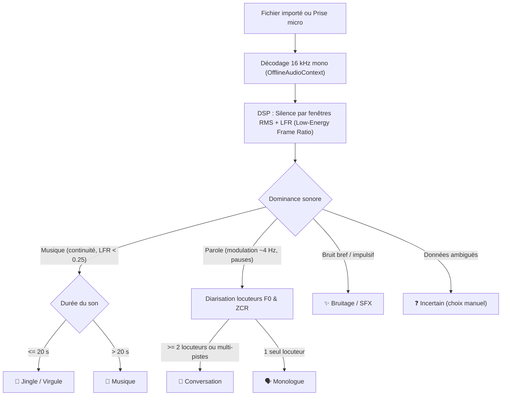

# Diagnostic et Analyse : Problème de Classification Audio (« Tout est repassé en monologue »)

Ce document décrit en détail les causes techniques, architecturales et algorithmiques pour lesquelles les blocs audio du studio de podcast retombent systématiquement sur le statut **« Monologue »**, ainsi que les solutions structurelles pour y remédier.

---

## 1. Résumé du Constat

Dans l'interface du studio, plusieurs types de contenus sonores distincts (un jingle musical, une virgule sonore, une interview à deux voix, une conversation enregistrée au micro ou importée) sont tous affichés avec le badge :
> 🗣️ **Monologue (Voix solo / Récit)**

Même après avoir enrichi l'algorithme de discrimination, le rafraîchissement de la page ou l'ajout de nouveaux sons ramène tous les blocs à l'état de monologue.

---

## 2. Analyse des Causes Racines

### Cause 1 : L'asynchronisme de l'Audio face au Rendu Synchrone du DOM
* **Le problème** : 
  L'extraction des caractéristiques DSP (`computeAcousticFeatures`) nécessite le décodage physique des échantillons audio via l'API Web Audio (`AudioContext.decodeAudioData`). Cette opération est obligatoirement **asynchrone** (renvoie une `Promise`).
  À l'inverse, l'affichage de l'interface graphique (`createBlockCard`, `renderNatureBadge`) est **synchrone**.
* **La conséquence** :
  Lorsqu'une carte de bloc est construite dans le DOM, l'audio n'est pas encore décodé ou l'attribut `clip.acousticFeatures` est encore `null`.
  La fonction synchrone `classifyBlockContent(block)` ne peut donc pas consulter le Silence Ratio, la variance RMS ou le ZCR du son. Elle doit décider à l'aveugle.

---

### Cause 2 : Le « Fallback » par Défaut de l'Algorithme
Dans le moteur `classifyBlockContent(block)` :
1. Le bloc n'est pas vide.
2. Pas de `customNature` forcé.
3. Si le mot-clé exact n'est pas dans le titre et que `acousticFeatures` est `null` :
   - Échec du test Musique / Jingle.
   - Échec du test Bruitage / SFX.
   - Échec du test Dialogue / Conversation (car sur 1 seule piste sans mot-clé explicite, le score conversation est de 0).
4. **Ligne de repli finale** :
   ```javascript
   return { type: 'monologue', label: 'Monologue', icon: '🗣️' };
   ```
Tout bloc dont la signature acoustique n'a pas pu être résolue instantanément retombe **mathématiquement sur Monologue**.

---

### Cause 3 : Noms de Prises et Fichiers Génériques
Dans une utilisation réelle :
* L'enregistrement rapide au micro nomme la prise **`Prise`** (`src/ui/block-quick.js`).
* L'import depuis la bibliothèque ou les fichiers donne souvent des noms techniques : `enregistrement.wav`, `audio_01.mp3`, `piste_1.wav`, `intro.wav`, ou simplement `Clip`.
* Ces noms ne contiennent pas les chaînes exactes `jingle` ou `dialogue`.
* Privé d'analyse acoustique immédiate, l'algorithme ne dispose d'aucun indice textuel et conclut au monologue.

---

### Cause 4 : Non-persistance des Caractéristiques Acoustiques (`acousticFeatures`)
* Lorsqu'un projet est sauvegardé dans `localStorage` (`serializeProject`), les clips sont sérialisés au format JSON.
* Si le projet est rechargé ou si le composant est remonté par le routeur ou par le rechargement à chaud (Vite HMR) :
  - Les instances de blocs sont reconstruites.
  - Si les `acousticFeatures` n'ont pas été persistées dans la base de données IndexedDB (`recordings`) ou si elles sont écrasées lors d'une mise à jour de clip (`onUpdate`), elles redeviennent `null`.
  - Au rendu suivant, le bloc rebascule en **Monologue**.

---

### Cause 5 : Dialogue sur Piste Unique (Micro Partagé ou Fichier d'Interview Unique)
* Une interview enregistrée avec un seul microphone (ou fournie dans un fichier MP3 unique) se présente sous la forme d'un **clip unique sur une seule piste**.
* Sans analyse de la hauteur de voix ($F_0$) et de l'alternance des timbres vocaux dans le flux audio :
  - Le nombre de pistes actives est $1$.
  - Le nombre de clips est $1$.
  - Il n'y a aucun chevauchement temporel.
  - L'algorithme attribue $+25$ points au monologue (`block.clips.length === 1 && tracks <= 1`).
  - Le dialogue est donc classé comme monologue.

---

### Cause 6 : La Musique prise pour une Conversation (Changements d'accords & Diarisation)
* **Mécanisme du bogue** :
  - La musique comporte des variations d'accords, des riffs, des mélodies et des percussions.
  - Dans l'ancien classifieur, si la dynamique RMS dépassait $0.08$ (ce qui est systématique sur un morceau avec batterie ou refrain), la musique était rejetée du filtre musical et tombait dans l'étape de diarisation vocale.
  - La diarisation comparait les hauteurs de note ($F_0$) entre mesures : le passage d'une note à une autre (ex: $150\,\text{Hz} \to 220\,\text{Hz}$) était comptabilisé comme un saut de locuteur (`pitchShifts >= 1`).
  - L'algorithme estimait ainsi $\ge 2$ locuteurs et classait le morceau en **Conversation** (`👥`).
* **Correction appliquée** :
  - Détection précoce Parole vs Musique via le **Low-Energy Frame Ratio (LFR)** et le ratio de trames silencieuses.
  - **Règle absolue d'exclusion** : un signal identifié comme musical n'est **JAMAIS** soumis à la diarisation de locuteurs.

---

### Cause 7 : Le Jingle pris pour un Monologue (Calcul de silence point par point)
* **Mécanisme du bogue** :
  - L'ancien calcul de silence vérifiait $|s[i]| < 0.02$ échantillon par échantillon. Or, toute onde sinusoïdale passe par zéro à chaque cycle. Sur un son à niveau modéré ($A \approx 0.08$), $15\%$ à $25\%$ des échantillons instantanés tombaient sous le seuil, faussant le ratio de silence.
  - Le jingle ne satisfaisait donc pas `silenceRatio < 0.15` et retombait sur la branche finale de monologue.
* **Correction appliquée** :
  - Mesure de l'énergie par **fenêtres RMS de 20-30 ms**. Un jingle ou une musique continue présente un ratio de trames silencieuses très faible ($< 0.12$).
  - Tout signal musical d'une durée $\le 20\,\text{s}$ est classé directement en **🔔 Jingle / Virgule**.

---

## 3. Plan d'Action & Architecture Implémentée (v2.3.0)



